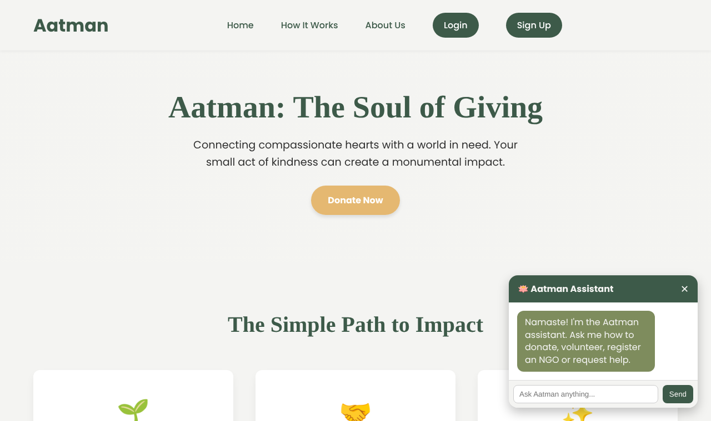
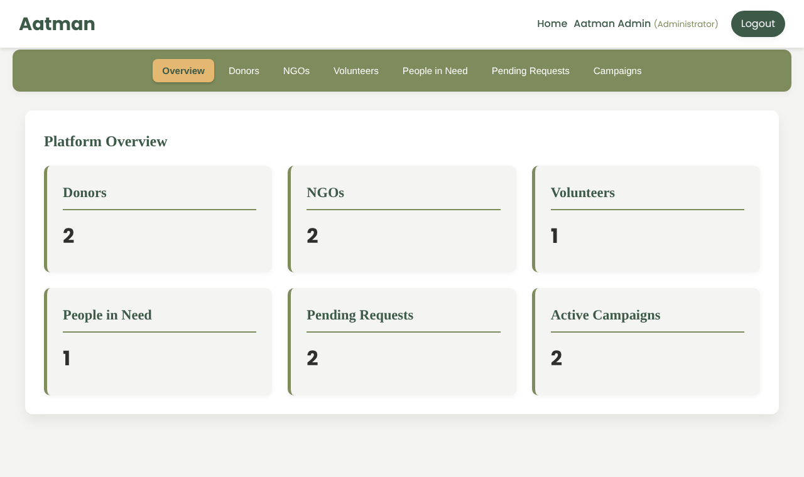
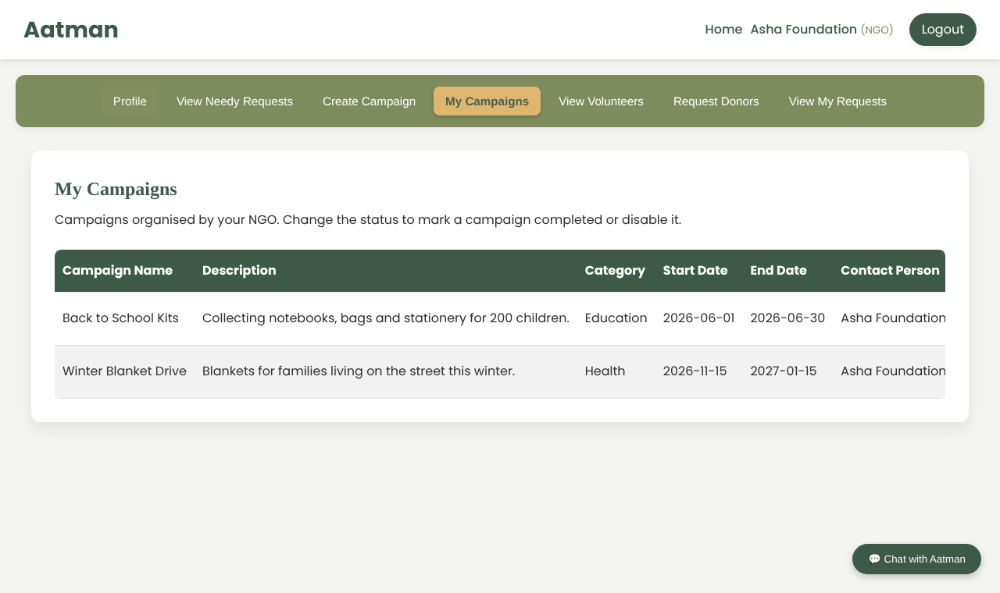
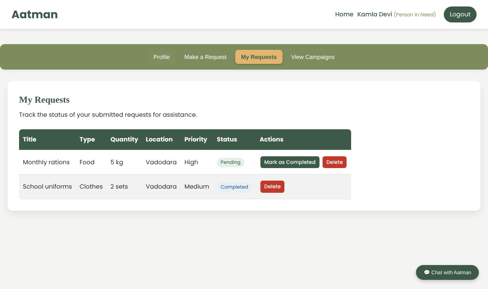

# Aatman: The Soul of Giving

[](https://github.com/Suzzanpatel/Aatman/actions/workflows/ci.yml)


**Aatman** is a multi-role social-impact management platform. It connects **people in need**, **donors**, **NGOs** and **volunteers**, with an **administrator** overseeing the whole platform. It also includes an **AI assistant** (Google Gemini) to guide users, and a **language selector** on every page so anyone can use it in their own language.

> Built with PHP 8, MySQL/MariaDB, HTML/CSS and vanilla JavaScript. No framework and no Composer dependencies.

---

## Highlights

| Area | What it shows |
|---|---|
| **Full-stack development** | Server-rendered PHP pages, a JSON API for the chatbot, responsive CSS and progressive-enhancement JS (tabs, inline editing, auto-submit) |
| **Backend engineering** | A single bootstrap, a config loaded from the environment, a prepared-statement DB layer, a shared repository/view layer, transactions, and logged errors with safe messages |
| **Relational database design** | A normalised schema: one `users` table plus 1:1 role-profile tables (shared-PK foreign keys), `ON DELETE CASCADE`, ENUM domains, CHECK constraints, composite indexes, and a data-preserving migration |
| **Role-based access control** | 5 roles, per-request role checks against the DB, ownership-scoped writes (no IDOR), admin-only user management, and admins can't be created through sign-up |
| **Security** | CSRF tokens, hardened sessions, login throttling, bcrypt with rehash, output escaping, secrets in `.env`, least-privilege DB user, and security headers. See [docs/SECURITY.md](docs/SECURITY.md) |

## Screenshots

| Landing page + AI assistant | Admin overview |
|---|---|
|  |  |
| **NGO: campaign management** | **Person in need: my requests** |
|  |  |

## Features by role

| Role | Can do |
|---|---|
| **Person in need** (`need`) | Post help requests (food, shelter, medicine…), mark them completed or delete them, browse active NGO campaigns, edit their profile, deactivate their account |
| **NGO** (`ngo`) | View needy requests, create campaigns and manage their status, browse available volunteers, post requests to donors, edit the organisation profile |
| **Donor** (`donor`) | Browse open requests and active campaigns, set donation preferences, edit their profile |
| **Volunteer** (`volunteer`) | Set skills, availability and preferred cause, toggle availability, browse campaigns and requests |
| **Admin** (`admin`) | See platform stats, view all users by role, activate or deactivate accounts, view all requests, change any campaign's status |
| **Everyone** | AI chat assistant (on the landing page and dashboards) and the Google Translate language selector |

## Quick start (local)

Requirements: **PHP 8.1+** (with `mysqli` and `curl`) and **MySQL 8.0.16+ or MariaDB 10.4+**.

```bash
git clone https://github.com/Suzzanpatel/Aatman.git && cd Aatman

# 1. Database: creates DB `aatman` + least-privilege user `aatman_app`
#    (edit the password inside create_database.sql first)
mysql -u root -p < database/create_database.sql
mysql -u root -p aatman < database/schema.sql
mysql -u root -p aatman < database/seed.sql        # optional demo data

# 2. Configuration
cp .env.example .env        # set DB_PASS (and GEMINI_API_KEY for the chatbot)

# 3. Run
php -S 127.0.0.1:8080 -t public
```

Open <http://127.0.0.1:8080>. For XAMPP/WAMP, Apache and production, see **[docs/SETUP.md](docs/SETUP.md)**.

### Demo accounts (seed data only)

All demo accounts use the password **`Aatman@123`**:

| Role | Email |
|---|---|
| Admin | `admin@aatman.test` |
| NGO | `ngo@aatman.test` |
| Donor | `donor@aatman.test` |
| Volunteer | `volunteer@aatman.test` |
| Person in need | `needy@aatman.test` |

> Never load `seed.sql` on a public server. Create a real admin with `php scripts/create_admin.php "Name" you@example.org`.

## Project structure

```
Aatman/
├── public/                  ← web root: the only folder the browser can reach
│   ├── index.php            landing page
│   ├── login.php · signup.php · logout.php
│   ├── onboarding/          role-specific profile step after sign-up
│   │   └── ngo.php · donor.php · volunteer.php · needy.php
│   ├── dashboard/           one dashboard per role + action endpoints
│   │   ├── admin.php · ngo.php · donor.php · volunteer.php · needy.php
│   │   ├── campaign_create.php · campaign_status.php · request_action.php
│   │   └── index.php        redirects to the user's own dashboard
│   ├── api/chatbot.php      AI assistant JSON endpoint
│   └── assets/{css,js}/
├── includes/                ← PHP not reachable from the web
│   ├── bootstrap.php        loaded by every page: config, session, headers, CSRF
│   ├── config.php           .env loader + constants
│   ├── db.php               mysqli connection + prepared-statement helpers
│   ├── auth.php             login/logout, RBAC guards (require_role…)
│   ├── csrf.php             CSRF token helpers
│   ├── helpers.php          escaping, validation, redirects, flash messages, enums
│   ├── repository.php       shared queries (requests, campaigns, profile updates)
│   ├── views.php            shared HTML tables/forms
│   └── partials/            head, navbar, footer (+ chat widget)
├── database/
│   ├── create_database.sql  DB + least-privilege user
│   ├── schema.sql           full schema
│   ├── seed.sql             demo data (fictitious)
│   └── migrations/          upgrade path from the old Aatman_final.sql dump
├── scripts/create_admin.php CLI to create or promote an admin
├── tests/e2e_smoke.py       end-to-end functional + security tests
├── docs/                    user guide, setup, architecture, database, security, changelog, screenshots
├── .github/                 CI workflow, issue & PR templates
├── CONTRIBUTING.md · SECURITY.md
└── .env.example             configuration template (copy to .env)
```

## Documentation

| Document | Contents |
|---|---|
| [docs/USER_GUIDE.md](docs/USER_GUIDE.md) | What each role can do, step by step |
| [docs/SETUP.md](docs/SETUP.md) | Installation (built-in server, XAMPP, Apache), configuration, upgrading an old database, troubleshooting |
| [docs/ARCHITECTURE.md](docs/ARCHITECTURE.md) | Request lifecycle, layers, RBAC matrix, page and endpoint map |
| [docs/DATABASE.md](docs/DATABASE.md) | ER diagram, table reference, design decisions |
| [docs/SECURITY.md](docs/SECURITY.md) | Security controls and the vulnerabilities that were fixed |
| [docs/CHANGELOG.md](docs/CHANGELOG.md) | Every bug and security issue fixed in the overhaul |
| [CONTRIBUTING.md](CONTRIBUTING.md) | Dev workflow and coding conventions |

Each top-level folder also has its own `README.md` explaining its files.

## Testing

```bash
mysql -u root aatman < database/schema.sql && mysql -u root aatman < database/seed.sql
php -S 127.0.0.1:8080 -t public &
pip install requests && python3 tests/e2e_smoke.py
```

The same suite runs on every push and pull request through **GitHub Actions** (`.github/workflows/ci.yml`), together with a PHP lint and a scan for committed API keys. It runs 60+ checks. It covers every role's login and dashboard, profile updates, request and campaign flows, and the attacks that used to work: admin bypass, `role=admin` sign-up, IDOR, missing CSRF, stored XSS, unauthenticated campaign edits, brute force, and sessions that stayed alive after deactivation.

## Tech stack

PHP 8 (mysqli, cURL) · MySQL / MariaDB (InnoDB, utf8mb4) · HTML5 · CSS3 · vanilla JavaScript · Google Gemini API · Google Translate website widget · Font Awesome · Google Fonts
