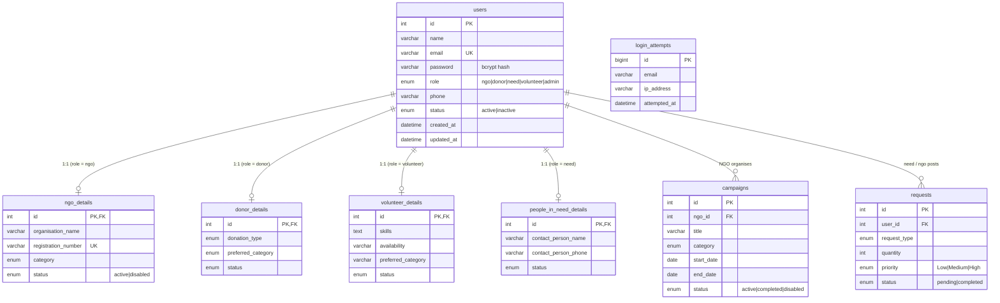

# Database Design

Engine **InnoDB**, charset **utf8mb4** (works with Hindi, Gujarati and other Indic scripts, and emoji). The full DDL is in [`database/schema.sql`](../database/schema.sql).

## Entity-relationship diagram

## Design decisions

**Shared-primary-key profile tables.** Every account lives in `users` (credentials, role, status). The role-specific columns go in a 1:1 table whose primary key is also a foreign key to `users.id`. This keeps `users` narrow and avoids dozens of nullable columns. It also lets a user have at most one profile row, enforced by the primary key, and makes authentication independent of role.

**Referential integrity.** All foreign keys use `ON DELETE CASCADE`, so deleting a user removes their profile, campaigns and requests. Orphaned rows can't exist.

**Domain constraints in the database.** Categories, donation types, request types, priorities and statuses are `ENUM`s. PHP mirrors them in `includes/helpers.php` and validates against the same lists. `CHECK` constraints enforce `end_date >= start_date` and `quantity >= 1`, so even a buggy client can't store impossible data.

**Two kinds of status.** `users.status` (`active | inactive`) controls whether someone can **log in**, and is checked on every request. `<role>_details.status` (`active | disabled`) controls whether the profile is **listed**. For example, a volunteer marks themselves "not available" without losing access.

**Snapshot columns on `requests`.** `user_name` and `user_role` record who posted a request at that moment. They are display and history fields; joins still go through `user_id`.

**Indexes for the actual queries.**

| Index | Used by |
|---|---|
| `users(email)` UNIQUE | login, duplicate-email check |
| `users(role, status)` | admin lists, volunteer directory |
| `requests(status, created_at)` | "pending requests" feeds on every dashboard |
| `requests(user_id)` | "My requests" |
| `campaigns(status, created_at)` | "active campaigns" feeds |
| `campaigns(ngo_id)` | NGO's own campaigns, ownership checks |
| `login_attempts(email, attempted_at)`, `(ip_address, attempted_at)` | brute-force throttling window |

**Passwords.** `password` is `VARCHAR(255)` so `password_hash(PASSWORD_DEFAULT)` can move to stronger algorithms. Old hashes are re-hashed on the next login (`password_needs_rehash`).

**Least privilege.** `create_database.sql` creates `aatman_app` with only `SELECT, INSERT, UPDATE, DELETE`. Even a compromised web process cannot drop tables or create users.

## Table reference

| Table | Purpose | Key columns |
|---|---|---|
| `users` | Every account | `email` unique; `role`; `status` |
| `ngo_details` | NGO profile | `registration_number` unique; `category` |
| `donor_details` | Donor preferences | `donation_type`, `preferred_category` |
| `volunteer_details` | Skills and availability | `skills`, `availability`, `preferred_category` (free text allowed for "Other") |
| `people_in_need_details` | Contact info for beneficiaries | `contact_person_name/phone` required |
| `campaigns` | NGO drives | `ngo_id` → `users.id`; `status`; date range |
| `requests` | Help requests from people in need and NGOs | `user_id` → `users.id`; `priority`; `status` |
| `login_attempts` | Failed logins in the throttle window | `email`, `ip_address`, `attempted_at` |

## Changes from the original `Aatman_final.sql`

| Original | Now | Why |
|---|---|---|
| Table `NGO_details`, but code used both `NGO_details` and `ngo_details` | `ngo_details` everywhere | Table names are case-sensitive on Linux MySQL, so NGO profile updates failed |
| `password VARCHAR(64)` | `VARCHAR(255)` | Room for future hash algorithms |
| No `login_attempts` | Added | Brute-force protection |
| No admin account and no way to create one | `scripts/create_admin.php` | Admin panel was unreachable legitimately (and reachable by everyone illegitimately) |
| `volunteer_details.preferred_category VARCHAR(255)`, "Other" text discarded | `VARCHAR(100)`, free text saved | Feature didn't work |
| No CHECK constraints, few indexes | CHECKs and composite indexes | Integrity and performance |
| Seed data contained what looked like real phone numbers and a home address | Fictitious `@aatman.test` demo data | Privacy |
| `INT` signed ids | `INT UNSIGNED` | Ids are never negative |

Existing databases are upgraded with [`migrations/001_upgrade_from_legacy_dump.sql`](../database/migrations/001_upgrade_from_legacy_dump.sql) (see [SETUP.md](SETUP.md)).
